# Course Transcriber

Turn a folder of course videos into things an AI can actually study:

1. **Transcripts**: every lesson transcribed locally (Whisper), with timestamps.
2. **Visual cues**: lines where the speaker is probably *showing* something on screen ("as you can see", "right here", "let me draw…") are tagged `[VISUAL]`.
3. **Snapshots**: compressed screenshots of the video around those moments, each listed next to the line being spoken, so an AI can read the transcript, look at the right pictures, and check what was drawn.
4. **Per-module bundles**: one file per module to upload, instead of dozens.
5. **Single files**: pick individual audio or video files (for example WhatsApp voice notes) and transcribe just those.
6. **Web videos**: paste YouTube (or other) links and it downloads, transcribes and snapshots them with the same pipeline.
7. **AI prompt**: a copy-paste prompt that points your AI at all of this (with the right paths for the computer you're on), plus a notes system so the AI keeps findings in small files instead of cluttering its context.

Everything runs **on your Mac**. Nothing is uploaded anywhere. You control it from a small panel that opens in your browser (no Terminal needed), or from the command line if you prefer.

<p align="center">
  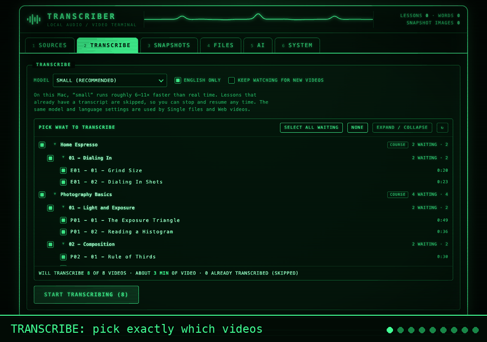
</p>
<p align="center"><sub>The panel on a demo library (original narrated lessons): real transcription and real snapshots, running locally. <a href="#screenshots">More screenshots below.</a></sub></p>

---

## Screenshots

All of these are from a demo library of original, narrated lessons (no private or copyrighted material), produced by running the real tool on it. The panel adapts down to a 320 px wide phone window.

| | |
|:--|:--|
| 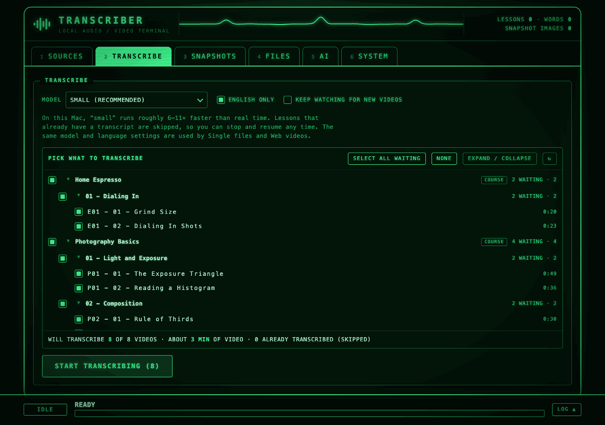<br>**Pick exactly what to transcribe.** Every video is listed by source and module; finished ones are greyed out, and a summary says exactly what will run. | 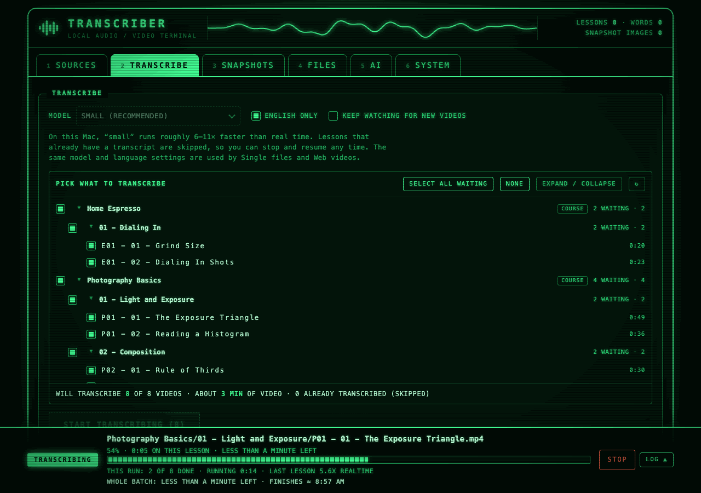<br>**Live progress, always on screen.** The dock shows the current lesson, time left for it, and an estimate for the whole batch. |
| 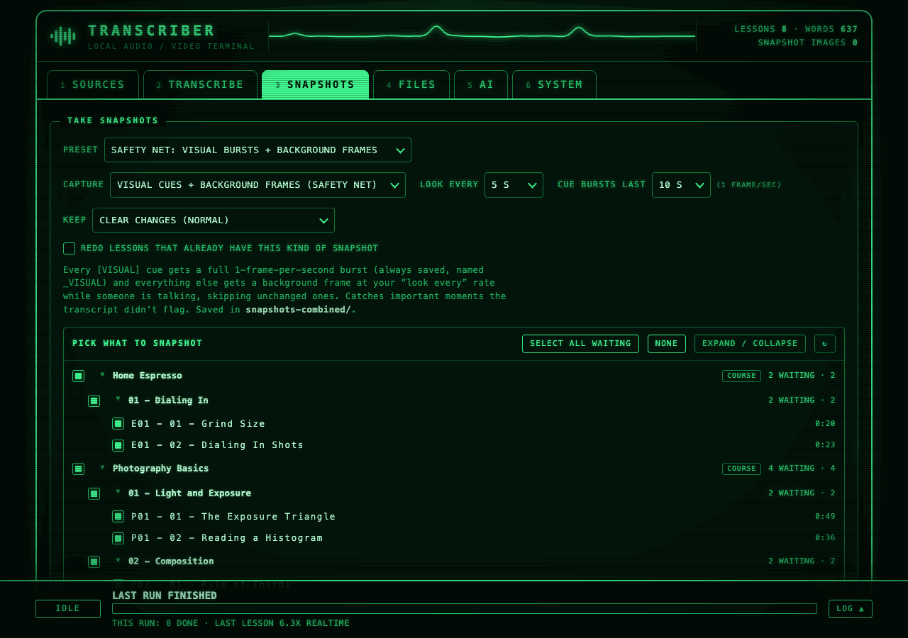<br>**Snapshots where it matters.** Presets capture a burst of frames whenever the speaker shows something on screen, plus background frames. | 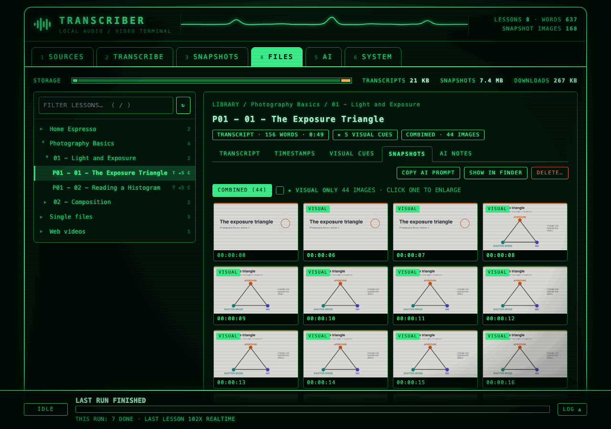<br>**Browse the snapshots** as a gallery, with a "visual only" filter. |
| 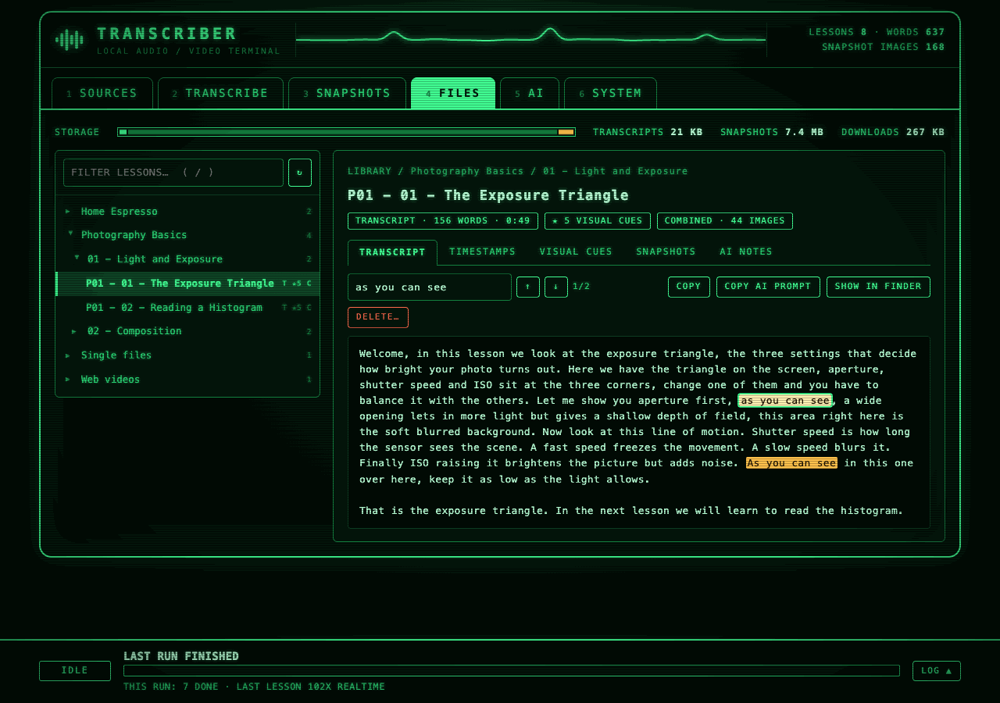<br>**Read every transcript** inside the app, with search. | 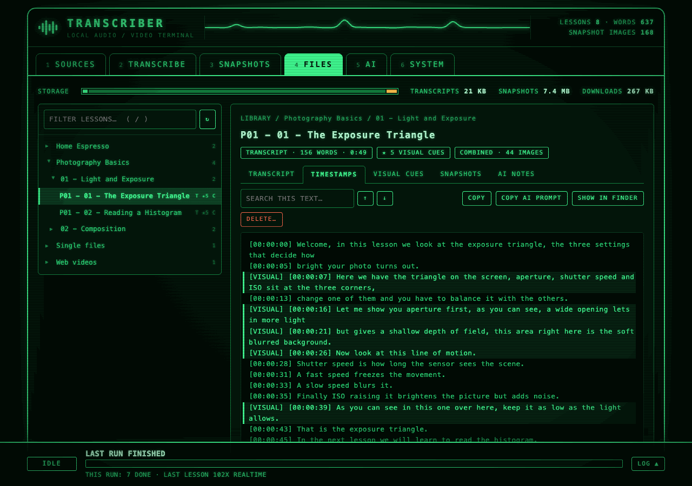<br>**`[VISUAL]` markers** show where something is on screen; click a line to jump to the nearest snapshot. |
| 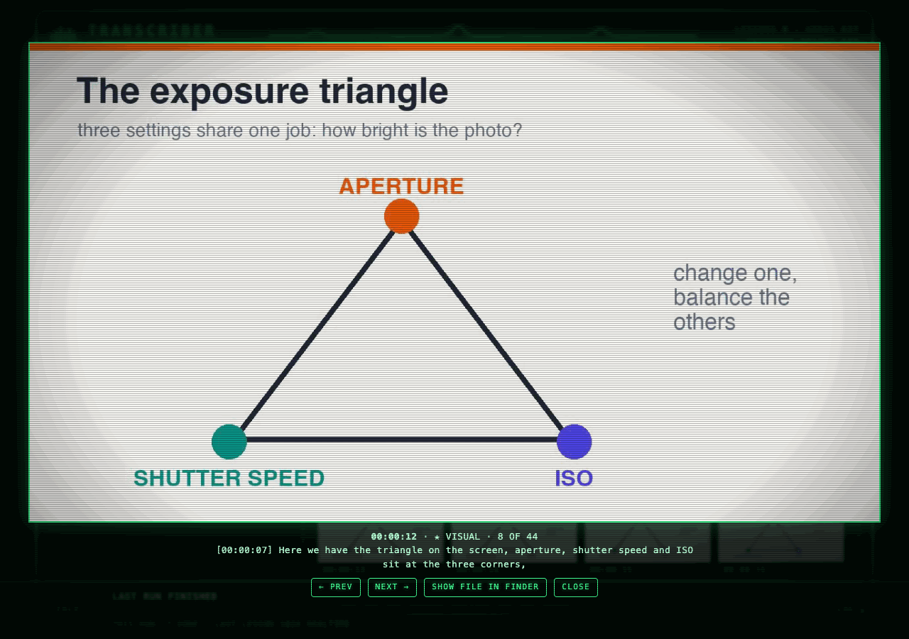<br>**Zoom in** and see the words spoken at that exact moment. | 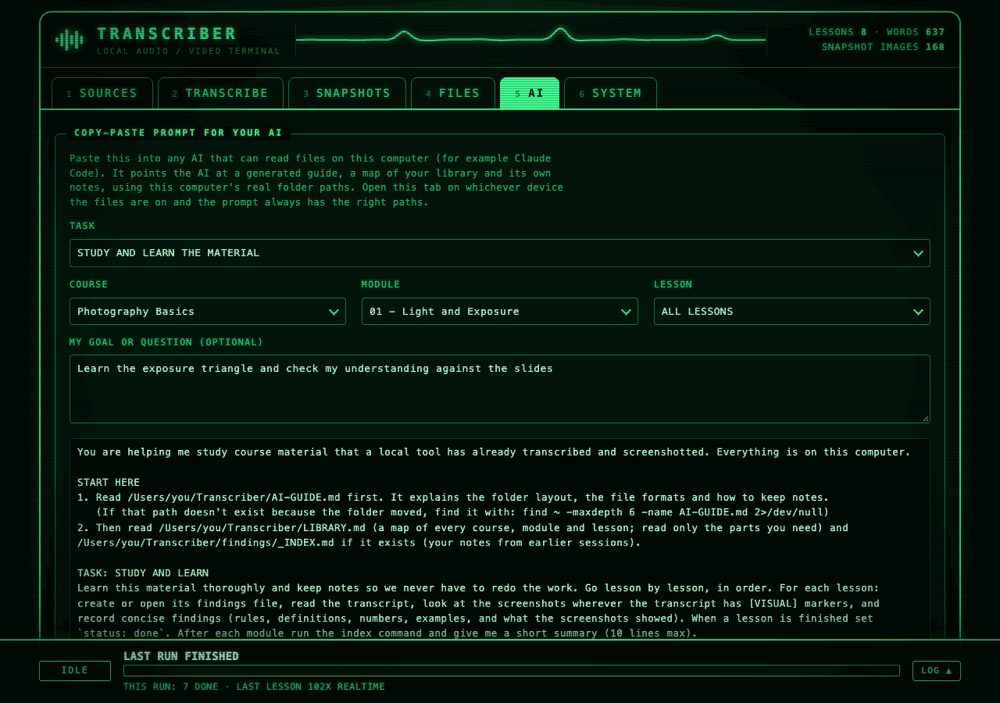<br>**One prompt for your AI.** Pick a course, module or lesson; the prompt points the AI at a generated guide and library map. |
| 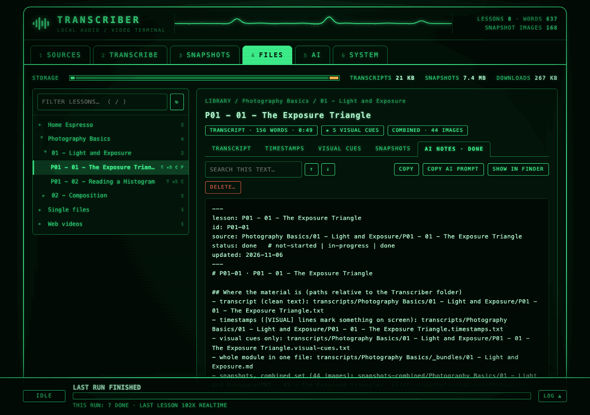<br>**The AI's notes**, one small file per lesson, readable in the app. | 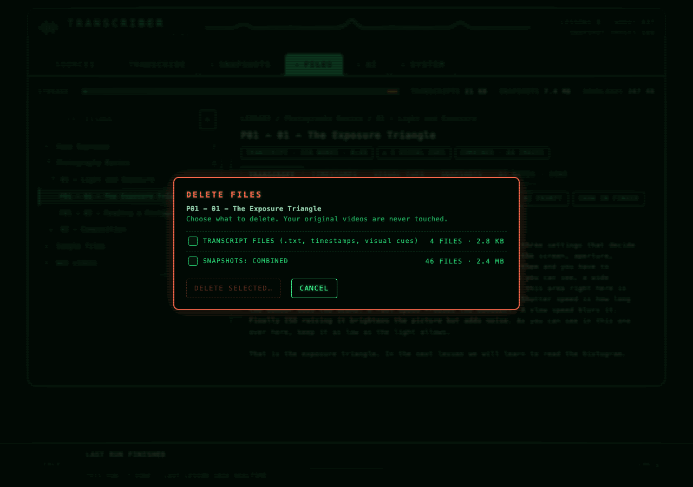<br>**Safe cleanup.** Deleting always shows what goes and how much space it frees; originals are never touched. |

<p align="center">
  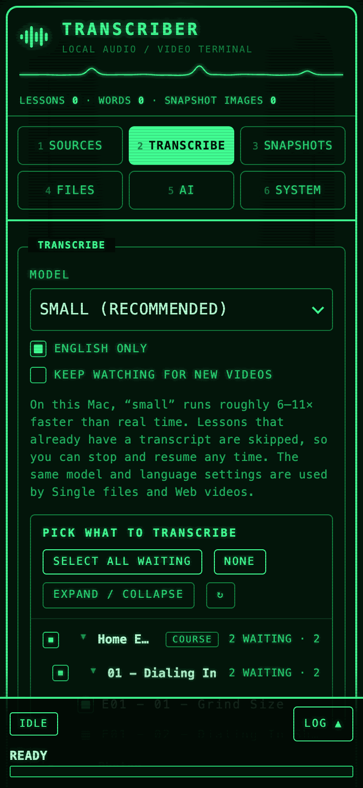
  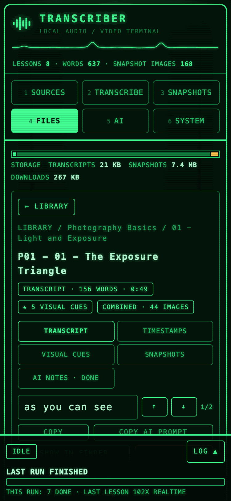
  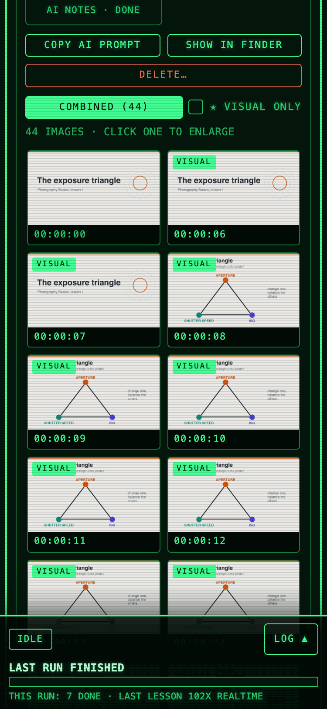
  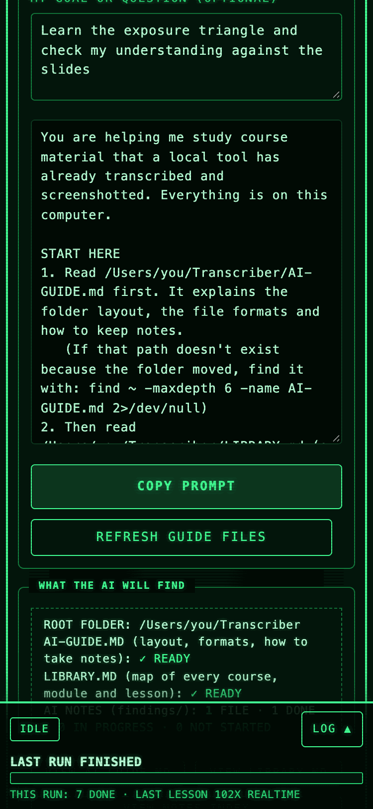
</p>
<p align="center"><sub>The same panel on a phone-sized window (375 px wide).</sub></p>

To regenerate these after changing the UI, run `python3 docs/make_screenshots.py --work /some/scratch/folder` (needs Google Chrome and `pip install websocket-client`).

---

## Contents

- [Screenshots](#screenshots)
- [Requirements](#requirements)
- [Install](#install)
- [Quick start](#quick-start)
- [Using the panel](#using-the-panel)
- [What you get (folder layout)](#what-you-get-folder-layout)
- [Snapshot presets and modes](#snapshot-presets-and-modes)
- [Single files (audio or video)](#single-files-audio-or-video)
- [Web videos (YouTube and other links)](#web-videos-youtube-and-other-links)
- [Using the results with an AI](#using-the-results-with-an-ai)
- [AI prompt and notes](#ai-prompt-and-notes)
- [Customising](#customising)
- [Command line reference](#command-line-reference)
- [Speed, disk space, and a real example](#speed-disk-space-and-a-real-example)
- [Troubleshooting](#troubleshooting)
- [Project layout](#project-layout)
- [Privacy and safety](#privacy-and-safety)
- [License, credits and disclaimer](#license-credits-and-disclaimer)

---

## Requirements

- **A Mac** (built and tested on an Apple Silicon M2 with 8 GB RAM, macOS, the system `python3` 3.9). Intel Macs should work but are untested.
- **Python 3.9 or newer.** The system `python3` that comes with Apple's Command Line Tools is fine. If `python3 --version` prints nothing, run `xcode-select --install`.
- **Internet on first run only**, to download the Python packages (about 230 MB) and the Whisper model (`small` is about 0.5 GB). After that it works offline.
- **No ffmpeg install needed.** Video decoding is handled by PyAV (from `faster-whisper`), and web downloads use a private ffmpeg from the `imageio-ffmpeg` package. Nothing to install with Homebrew.
- **For web downloads only: a Python 3.10+.** Current yt-dlp refuses to run on the Python 3.9 that Macs ship. The first launch sets this up automatically in the background (`setup-downloader.command`): it uses a Python 3.10+ if you have one, otherwise downloads a small standalone Python 3.12 (about 25 MB, into `~/.transcriber/python`) with the `uv` tool. Nothing is installed system-wide, no password is needed, and the transcriber itself keeps using your existing Python. Course transcribing and snapshots never need it.

## Install

```bash
git clone https://github.com/shaynefw/course-transcriber.git
cd course-transcriber
./make-app.command          # builds Transcriber.app (the double-clickable launcher + icon)
```

Then double-click **`Transcriber.app`** in the folder. The first launch sets up its Python environment automatically (a few minutes, once). It lives in `~/.transcriber/venv`, outside the project folder, so you never have to manage it.

> **If macOS blocks a file** ("cannot be opened because it is from an unidentified developer"), right-click it, choose **Open**, then **Open** again. This only happens once per file, and mostly if you downloaded a ZIP instead of using `git clone`.

> **Why is the environment not inside the project?** Python's `venv` breaks when a folder path contains a literal `$` character. Keeping the environment in your home folder avoids that.

## Quick start

1. Double-click **Transcriber.app**. A green-screen control panel opens in your browser (`http://127.0.0.1:8765`).
2. **1 SOURCES**: click **+ Add course folder** and pick the folder that holds your lessons (its subfolders are your modules).
3. **2 TRANSCRIBE**: leave the defaults and click **Start transcribing**.
4. When that finishes, **3 SNAPSHOTS**: leave the preset on *Safety net* (the default) and click **Take snapshots**.
5. **4 FILES**: browse and read the transcripts, look through the snapshots, and copy the upload bundles.

Your original videos are only ever **read**, never changed, moved or deleted.

---

## Using the panel

The panel looks like a handheld green-phosphor console: six tabs along the top, and a **progress dock that stays at the bottom of every tab**, so you always see what's running. Press **1–6** to switch tabs. (Turn the scanlines, glow and animated waveform off in SYSTEM if you prefer a flat look.) Even the drop-down menus, scroll bars and mouse cursors are themed, so nothing looks like a stock browser control.

**Small screens:** the layout adapts all the way down to a 320 px wide window (the smallest phone size). The tabs become a 3 + 2 grid of large buttons, the FILES tab shows one pane at a time (the library list, then the opened lesson with a **← LIBRARY** button), snapshot galleries become two columns, dialogs slide up from the bottom, the progress dock shrinks to a one-line summary, and you can swipe left and right in the picture viewer. Buttons get larger touch targets on touch screens. Note that the panel only listens on your own Mac (`127.0.0.1`), so a phone can't open it over Wi-Fi; this is for narrow browser windows and split screens, and it deliberately isn't exposed to your network.

### 1 SOURCES: where videos come from
Three sections:
- **COURSES**: the course folders you've added (picked single files and downloaded web videos have their own sections and aren't listed here), with how many lessons are transcribed and how many snapshot sets exist. **+ Add course folder** opens a macOS folder picker (the folder is *linked* into `videos/`, nothing is copied). **View files** jumps to that course in the FILES tab. **Remove** only unlinks it from the list.
- **SINGLE FILES**: pick individual audio or video files, such as WhatsApp voice notes, and transcribe just those. See [Single files](#single-files-audio-or-video). Shows what you've picked so far.
- **WEB VIDEOS**: paste YouTube (or other) links to download and process. See [Web videos](#web-videos-youtube-and-other-links).

### 2 TRANSCRIBE
| Setting | What it does |
|---|---|
| **Model** | `small` (recommended: about 6–11× faster than real time on an M2 and accurate enough for lectures), `base` (faster, rougher), `medium` (slower, more accurate with jargon), `tiny` (fastest, draft quality). |
| **English only** | On by default. Turn it off to auto-detect the language. |
| **Keep watching for new videos** | After finishing, keeps running and transcribes anything new you add to the folder. |

**Pick exactly what to transcribe.** Below the settings is a list of every video the tool can see, grouped by source (tagged **COURSE**, **PICKED FILES** or **WEB VIDEOS**) and then by module. Everything that's still waiting is ticked by default, and videos that already have a transcript are greyed out as "✓ DONE". Tick or untick single videos, whole modules, or whole sources (the group boxes show a partly-ticked state), or use **Select all waiting** / **None**. If an original file was moved or deleted, its row shows **ORIGINAL NOT FOUND** and a **Clear N missing** button appears (also in SOURCES → Single files). It lists the dead shortcuts and removes just those, never a real file, never anything inside a folder you linked; transcripts and snapshots already made stay (delete them in the FILES tab if you like). A summary line states exactly what will happen, for example *"Will transcribe 2 of 7 videos · about 2 min of video · 5 already transcribed (skipped)"*, and the button shows the count (**Start transcribing (2)**). With **Keep watching** ticked, the selection isn't used: everything new in all sources is transcribed as it arrives.

Lessons that already have a transcript are skipped, so you can stop and resume any time. Single files and Web videos use the same model and language settings.

### 3 SNAPSHOTS
See [Snapshot presets and modes](#snapshot-presets-and-modes). It has the same kind of selection list as TRANSCRIBE, showing which videos are still waiting for the chosen kind of snapshot (with **Redo** ticked, finished ones become selectable again). Best done *after* transcribing, because the cue moments come from the transcript.

### 4 FILES: browse, read and manage the results
This is where you look at what the tool produced, without opening Finder. A storage bar at the top shows how much space transcripts, snapshots and downloads use.

On the left is the library: **course → module → lesson**, with a filter box (press **/**). Small badges show what each lesson has: **T** transcript, **★n** visual cues, **A / V / C** the Overview / Visual-only / Combined snapshot sets, **D** a downloaded video. Click a course or module to see an overview, its `INDEX.md`, and the module's **upload bundle**. Click a lesson to see:

- **TRANSCRIPT**, **TIMESTAMPS** (the `[VISUAL]` lines are highlighted) and **VISUAL CUES**: readable in the panel, with a search box (Enter or the arrows step through matches) and a **Copy** button. Click a timestamp line to jump straight to the nearest snapshot.
- **SNAPSHOTS**: a thumbnail gallery for each set, with a "★ visual only" filter. Click a picture to enlarge it, see what was being said at that moment, and step through with the arrow keys.

**Showing files in Finder is optional.** Every view has a **Show in Finder** button, but you never need it to read or manage the files.

**Deleting files** (the **Delete…** button on a lesson, module or course):
1. Choose what to delete: the transcript files, each snapshot set separately, or a downloaded video. Each choice shows how many files and how much space it frees.
2. Confirm. Courses, modules and downloaded videos also require typing `DELETE`.

Deleting only ever touches the tool's own output folders (`transcripts/`, `snapshots*/`) and videos it downloaded into `videos/Web videos/`. **Your original videos are never touched**, symlinks aren't followed, and the root folders can't be deleted. It's refused while a job is running, and it can't be undone, so there is no trash or undo. After a delete, indexes and bundles are rebuilt, and the lesson counts as "not done" so the next run can recreate it. Deleting a downloaded video also removes it from the downloader's "already downloaded" list, so pasting its link again downloads it again.

### 5 AI
Builds the prompt you paste into your AI, and shows what the AI will find. See [AI prompt and notes](#ai-prompt-and-notes).

### 6 SYSTEM
Display options (CRT effects, waveform), buttons that open each output folder in Finder, **Re-tag visual cues** (re-applies your phrase list to existing transcripts, see [Customising](#customising)), **View failed files** (appears if any file couldn't be processed), the keyboard shortcuts, and **Quit Transcriber**. Closing the browser tab does *not* stop a running job; the panel keeps going until you quit it. After you quit, the page shows **Reopen Transcriber** (it starts the panel again through a `transcriber://` link handled by `Transcriber.app`, then reloads itself into the new panel) and **Close this tab**. If the panel ever stops unexpectedly, a **Reopen** button appears in the progress dock.

### The progress dock (always visible)
- **State and current file**: what's running, and which lesson, with a segmented progress bar.
- **Two time estimates**: *this lesson* ("about 6 min left") from how far through it is, and the *whole batch* ("about 1 h 23 min left · finishes ≈ 10:02 AM"), weighted by how much work each remaining lesson has (video length when transcribing, number of frames to look at for snapshots). It says "estimating…" for the first minute while it measures the speed, then refines as it goes. It is an estimate: speed varies with the content.
- **Stop** is always safe: finished lessons are kept, and the one in progress restarts next time. Only one job runs at a time; while one runs, the start buttons and settings are locked.
- **LOG ▲** opens the live log. **Copy log** copies the whole thing (handy for sharing an error). Multi-step jobs (a web download, then transcribe, then snapshots) show "step 2 of 3".

---

## What you get (folder layout)

Everything is created next to the scripts and mirrors your folder structure. `<course>` is the folder you added; below it are your modules and lessons.

```
course-transcriber/
├── videos/<course>/<module>/lesson.mp4           ← links to your folders (originals untouched)
│   ├── Single files/…                            ← files you picked in SOURCES → Single files (links)
│   └── Web videos/…                              ← downloads from SOURCES → Web videos
│
├── transcripts/<course>/
│   ├── INDEX.md                                  ← every lesson: duration, word count, visual-cue count
│   ├── _bundles/<module>.md                      ← ALL lessons in a module, one file, timestamps included
│   └── <module>/
│       ├── lesson.txt                            ← clean paragraphs
│       ├── lesson.timestamps.txt                 ← [HH:MM:SS] per line; [VISUAL] on flagged lines
│       └── lesson.visual-cues.txt                ← just the flagged lines (the "look at the screen" list)
│
├── snapshots/            ← "Overview" preset
├── snapshots-visual/     ← "Frame-by-frame visuals" preset
└── snapshots-combined/   ← "Safety net" preset
      └── <course>/<module>/<lesson>/
          ├── 00-04-37.jpg                        ← a frame at 00:04:37
          ├── 00-04-38_VISUAL.jpg                 ← a frame from a [VISUAL] moment
          └── _snapshots.txt                      ← each picture next to the line being spoken
```

A **timestamps** line looks like this:

```
[VISUAL] [00:00:07] Here we have the triangle on the screen, aperture, shutter speed and ISO sit at the three corners,
[00:00:13] change one of them and you have to balance it with the others.
```

A **`_snapshots.txt`** line looks like this:

```
00-00-12_VISUAL.jpg   [00:00:07] Here we have the triangle on the screen, aperture, shutter speed and ISO sit at the three corners,
```

> **Resumable:** a lesson counts as transcribed once its `lesson.txt` exists, and as snapshotted once its snapshot folder has a `.done.json`. Re-running skips finished work. A file that fails is logged in `_failed.log` (inside `transcripts/` or the relevant snapshots folder) and skipped, and the rest carry on.

---

## Snapshot presets and modes

Snapshots are JPEGs, scaled to at most 1280 px wide (chart labels stay readable), saved at quality 78 (about 80 KB each). The **Preset** dropdown sets the controls below for you; changing any control switches it to **Custom**.

| Preset | Capture | What it saves | Saved in |
|---|---|---|---|
| **Frame-by-frame visuals** | only around visual cues | At every `[VISUAL]` line: a frame **every second** from 1 s before the line to **10 s** after, **even if nothing moved**. | `snapshots-visual/` |
| **Safety net** (default) | visual cues + background frames | The same 1-second bursts at every cue, **plus** a background frame every 5 s while someone is talking (unchanged frames skipped). Catches important moments the transcript *didn't* flag. | `snapshots-combined/` |
| **Overview** | everything while talking | A frame every 5 s while someone is talking, skipping frames that look like the last saved one; always includes a frame at each cue. | `snapshots/` |

The controls:

| Control | Options |
|---|---|
| **Capture** | everything while talking · only around visual cues · visual cues + background frames |
| **Look every** | 1 s · 3 s · 5 s · 10 s · 15 s · 30 s (in the cue-only mode this is the burst's frame rate; in the safety net it is the *background* rate, bursts are always 1 s) |
| **Cue bursts last** | 5 s · 10 s after each cue (cue modes only) |
| **Keep** | every look, even if nothing changed · every small change (sensitive) · clear changes (normal) · only big changes (relaxed) |
| **Redo lessons that already have this kind of snapshot** | Off by default, because finished lessons are skipped. Tick it after changing settings or the phrase list. It only redoes the folder for the mode you selected. |

How "changed" is decided: each look is shrunk to a small grayscale picture and compared with the last *saved* one. A frame is kept if at least 0.3 / 1 / 3 % of the pixels changed noticeably (sensitive / normal / relaxed). That means a static slide produces one image, but a drawn line or a new candle on a chart is enough to keep a frame.

"Only while someone is talking" uses the transcript: exact speaking times for lessons transcribed with this version, estimated times for older transcripts, or voice detection if there is no transcript yet. (Cue bursts need a transcript; a lesson without one is skipped in cue-only mode, and gets background frames only in the safety net.)

---

## Single files (audio or video)

The **SOURCES → Single files** section transcribes individually chosen files, without needing a course folder. It's meant for things like **WhatsApp voice notes**, phone recordings and one-off videos.

1. Click **Choose files and transcribe…** and pick one or more files in the macOS dialog (hold ⌘ or Shift to select several).
2. Choose the **language**: *Auto-detect* (default, safest for voice notes) or *English*. The detected language is shown in the log.
3. Tick **Also take snapshots** if they're videos and you want screenshots too (audio files are skipped automatically).

It uses the model chosen in the TRANSCRIBE tab (`small` is plenty for voice notes). The files are *linked* into `videos/Single files/` (your originals are only read, never moved or changed), and the results appear in `transcripts/Single files/`, with the same `.txt`, `.timestamps.txt`, `INDEX.md` and bundle as everything else. Two files with the same name from different folders get a number added so neither is overwritten.

**Formats:** `.ogg` and `.opus` (the Opus audio WhatsApp uses for voice notes), `.mp3`, `.m4a`, `.wav`, `.aac`, `.flac`, `.oga`, `.amr`, `.wma`, `.aiff`, `.caf`, and the video types `.mp4`, `.mov`, `.mkv`, `.avi`, `.webm`, `.m4v`, `.flv`, `.wmv`, `.3gp`, `.mpg`. I checked a real WhatsApp `.ogg` voice note (Opus audio in an Ogg container) end to end; the other formats rely on the same decoder and haven't each been tested.

**Getting WhatsApp voice notes onto your Mac:** save or share the voice note to a place you can reach (for example your Downloads folder), then choose it here. Where WhatsApp keeps the files and whether re-sharing changes the format varies by phone and app version, so I haven't verified that part. Any of the supported formats above works.

---

## Web videos (YouTube and other links)

**SOURCES → Web videos** is a separate section, so your course folders are never touched.

1. Paste one or more links (one per line). Single videos and playlists both work.
2. Pick the quality (720p, 1080p, or best available). 1080p is the default because chart text is much easier to read in screenshots.
3. Leave **Transcribe** and **Take snapshots** ticked to run the whole pipeline, or untick them to just download.
4. Click **Download & process**.

What it does, as one job with up to three steps (shown in the progress dock as "step 1 of 3…"):

1. **Download** with [yt-dlp](https://github.com/yt-dlp/yt-dlp) into `videos/Web videos/<playlist or channel>/`. Videos in a playlist keep their order (`01 - …`, `02 - …`); standalone videos go in `Single videos/` or under the channel name when it's known. `videos/Web videos/_sources.txt` records each video's title, link, channel and upload date so you can cite it later.
2. **Transcribe** just the new web videos (`transcribe.py --only "Web videos"`).
3. **Snapshots** just the new web videos, using whatever is currently set in the SNAPSHOTS tab (preset, interval, etc.).

Because `Web videos` is treated as a course, you get everything the course videos get: an `INDEX.md`, module bundles (one per playlist), `[VISUAL]` cues, and snapshot folders.

Good to know:
- **The downloaded videos stay on disk** (so you can redo snapshots with different settings). They can be large; delete them from `videos/Web videos/` when you're done. The transcripts and snapshots are separate and unaffected.
- **Resumable:** videos already downloaded are skipped, so you can paste the same playlist again to pick up new videos.
- **If downloads start failing**, YouTube probably changed something. Click **Update downloader** (it runs `pip install -U yt-dlp`).
- **Private, members-only, or age-restricted videos** need you to be signed in, which this tool doesn't do. They'll show as failed.
- **"If a link is a video inside a playlist, take the whole playlist"** is off by default, so a `watch?v=…&list=…` link downloads just that one video.
- **Terms and copyright:** only download videos you're allowed to keep for personal study. Many sites' terms restrict downloading, and that's your call.
- **Why a second Python environment:** the downloader lives in `~/.transcriber/venv-dl` (Python 3.12) because current yt-dlp won't run on Python 3.9. If it's missing, run `./setup-downloader.command`. To remove it, delete `~/.transcriber/venv-dl` and `~/.transcriber/python`.

On the command line: `~/.transcriber/venv-dl/bin/python webdl.py URL [URL …] [--quality 720|1080|best] [--playlist]`.

---

## Using the results with an AI

A workflow that works well:

1. Upload a module's **bundle** (`transcripts/<course>/_bundles/<module>.md`). It contains every lesson, timestamps included, with `[VISUAL]` markers.
2. Upload the lesson's **`_snapshots.txt`** and the snapshot images for the moments you care about (or the whole lesson folder if the upload limit allows).
3. Ask the AI to read the transcript and check the screenshots where the speaker shows something.

Because `_snapshots.txt` ties every image file to the sentence being spoken, the AI can say "look at `00-09-47_VISUAL.jpg`" instead of guessing a time range. If it needs a frame that wasn't captured, switch to a denser setting and tick **Redo**.

---

## AI prompt and notes

The **AI** tab gives you one prompt to paste into any AI that can read files on your computer (for example Claude Code). You pick a **task**, optionally narrow the **focus** to a course, module or lesson, and optionally type your goal. Then click **Copy prompt**.

The prompt is short. It tells the AI to read three generated files, in this order, and then do the task:

| File | What it is |
|---|---|
| `AI-GUIDE.md` | How the folders and files are laid out (transcripts, timestamps with `[VISUAL]` markers, bundles, the three snapshot sets, `_snapshots.txt`), how to study efficiently without flooding its context, and how to take notes. |
| `LIBRARY.md` | A compact map of every course, module and lesson: duration, words, visual-cue count, which snapshot sets exist, and whether the AI has notes on it. |
| `findings/_INDEX.md` | The AI's own notes index from earlier sessions (once any exist). |

**Paths are detected, not hard-coded.** The panel writes the guide, the library map and the prompt using the folder it is actually running from, so they're correct on every Mac, and again if you move the folder (click **Refresh guide files**). They hold machine-specific paths, so they're generated fresh and not committed to git. If a path ever doesn't exist, the prompt tells the AI how to find `AI-GUIDE.md` itself. The notes files only use paths relative to the folder, so they stay valid when you copy them to another device.

**Tasks.** *Study and learn* (go lesson by lesson and record findings), *Continue from its notes* (read the index and pick up unfinished lessons without re-reading finished ones), *Answer my questions* (use the notes first, open transcripts or screenshots only to verify, and cite timestamps and image names).

**Notes that save context.** The AI keeps what it learns in one small file per lesson, `findings/<course>/<ID>-findings.md`, instead of in the chat. The ID comes from the file name (`P01 - 02 - Reading a Histogram` becomes `P01-02`; other names become a short slug plus a hash, so they're always unique). Each file starts with a small header (`lesson`, `id`, `source`, `status: not-started | in-progress | done`, `updated`) and has sections for where the material is, a summary, key rules and numbers (each ending with a `[HH:MM:SS]` or image-name source), what the screenshots showed, and open questions. The AI creates a file with a command that pre-fills the paths:

```bash
python3 findings.py new "P01-02"     # or any unique part of the lesson's name
python3 findings.py path "P01-02"    # show a lesson's file paths
python3 findings.py list             # status of every notes file
python3 findings.py index            # rebuild findings/_INDEX.md
python3 findings.py guide            # regenerate AI-GUIDE.md and LIBRARY.md
python3 findings.py prompt --lesson "P01-02" --task study     # print a prompt without the panel
```

If the AI can't run commands it can create the file itself from the template in `AI-GUIDE.md`. You can read the notes in the **FILES** tab: open a lesson and choose **AI NOTES** (lessons with notes show an **F** badge), and **Copy AI prompt** on any lesson, module or course copies a focused prompt straight from there. The AI is told to write only inside `findings/` and never to touch transcripts, snapshots or videos.

---

## Customising

### Which phrases count as a visual cue
Edit the `VISUAL_PHRASES` list at the top of [`transcribe.py`](transcribe.py) (plain lowercase phrases, whole-word matches). Then click **Re-tag visual cues** in the panel (or run `python3 transcribe.py --retag`). That re-tags existing transcripts without re-transcribing and rebuilds the indexes and bundles. To refresh snapshots, run them again with **Redo** ticked.

Broad phrases such as `drag` or `this one` catch more real moments *and* more false alarms. If a lesson gets noisy, remove them.

### Snapshot defaults
The constants at the top of [`snapshots.py`](snapshots.py): `INTERVAL`, `CHANGE_PCT`, `PIXEL_DELTA`, `JPEG_QUALITY`, `MAX_WIDTH`, `SPEECH_PAD`, `CUE_DELAY`, and the burst settings `VISUAL_BEFORE`, `VISUAL_AFTER`, `VISUAL_STEP`.

### The look of the panel
The colours are variables at the top of `ui/style.css` (`--g` is the main green, `--bad` the delete red). Edits to the files in `ui/` show up when you refresh the page, with no restart needed.

### The icon
`assets/make_icon.py` redraws the app icon and favicon. After changing it, run `./make-app.command` to rebuild the app with the new icon.

---

## Command line reference

The panel just runs these scripts, so you can also use them directly. Use the environment's Python so the packages are found:

```bash
~/.transcriber/venv/bin/python transcribe.py      # transcribe everything new in ./videos
```

**`transcribe.py`**

| Option | Meaning |
|---|---|
| `--model small` | `tiny`, `base`, `small` (default), `medium`, `large-v3`, `distil-large-v3` |
| `--lang en` | Language code, or `auto` to detect (default `en`) |
| `--watch` | Keep running and pick up new files |
| `--retag` | Re-apply `VISUAL_PHRASES` to existing transcripts, rebuild indexes, exit |
| `--reindex` | Only rebuild `INDEX.md` and the bundles |
| `--only "Folder"` | Only handle videos inside that folder of `./videos` (also available in `snapshots.py`) |
| `--select-file list.json` | Only handle the videos in this JSON list of paths relative to `./videos` (what the panel's selection lists use; also available in `snapshots.py`) |

**`snapshots.py`**

| Option | Meaning |
|---|---|
| `--interval N` | Seconds between looks (default 5; 1 in cue-only mode) |
| `--visual-only` | 1-second bursts around `[VISUAL]` lines → `snapshots-visual/` |
| `--combined` | Background frames + bursts → `snapshots-combined/` |
| `--burst N` | Seconds of frames after each cue (default 6) |
| `--change N` | Minimum % of the picture changed to keep a frame (default 1; `0` = keep every look) |
| `--quality N` | JPEG quality (default 78) |
| `--all-video` | Ignore speech, look through the whole video |
| `--redo` | Redo lessons that already have snapshots of this kind |

The preset *Frame-by-frame visuals* is equivalent to:

```bash
~/.transcriber/venv/bin/python snapshots.py --visual-only --interval 1 --burst 10 --change 0
```

and *Safety net* to:

```bash
~/.transcriber/venv/bin/python snapshots.py --combined --interval 5 --burst 10 --change 1
```

**Launchers** (double-clickable, no Terminal knowledge needed): `transcribe.command` transcribes everything new, then waits for a key press; `transcribe-watch.command` does the same but keeps watching for new files; `gui.command` starts the panel (used by `Transcriber.app`).

---

## Speed, disk space, and a real example

Measured on an Apple M2, 8 GB RAM, `small` model:

| Job | Speed |
|---|---|
| Transcribing | roughly **6–11× faster than real time** (a 1-hour lesson in about 6–10 minutes) |
| Snapshots | roughly **25–400× faster than real time** (depends on the mode; more saved frames = slower) |

Disk space: a snapshot set averages about 80 KB per image. In one real run of the **Safety net** preset over **155 lessons**, the result was about **42,600 images, 3.6 GB** (roughly 275 images, 23 MB per lesson). The cue-only *Frame-by-frame* preset produces fewer images than the Safety net, and *Overview* fewer still. Your numbers will vary with how often the speaker draws or points at things. You can delete a snapshot folder at any time; it can always be regenerated.

---

## Troubleshooting

| Problem | Fix |
|---|---|
| Double-clicking `Transcriber.app` does nothing for a few seconds | Normal on the very first launch (it's setting up). Wait up to a minute, or open `~/.transcriber/gui.log` for details. |
| The page says "panel stopped" | The panel was quit or crashed. Click **Reopen** in the progress dock (or on the "Transcriber closed" screen), or double-click `Transcriber.app`. Finished work is kept. |
| **Reopen Transcriber** does nothing | Your copy of `Transcriber.app` predates this feature: run `./make-app.command` once to rebuild it. Browsers also ask "Open Transcriber?" the first time; choose Open (tick "always allow" if offered). If it still doesn't start, double-click `Transcriber.app`; the waiting page reconnects by itself. |
| Setup fails | Run `./transcribe.command` from Terminal to see the actual error. Check you're online and `python3 --version` works. |
| macOS says the app/script can't be opened | Right-click it → **Open** → **Open**. |
| The app has a plain icon in Finder or Dock | Run `./make-app.command`, then `killall Finder Dock`. |
| "needs a transcript first; skipping" | Cue-only snapshots use the `[VISUAL]` lines. Transcribe that lesson first (or use the Safety net / Overview preset). |
| A lesson has no `[VISUAL]` cues, but the speaker clearly shows things | Add the phrases they use to `VISUAL_PHRASES`, click **Re-tag visual cues**, then re-run snapshots with **Redo**. Or use the Safety net preset. |
| Too many near-identical images (e.g. a webcam in the corner keeps moving) | Set **Keep** to *only big changes (relaxed)*, or use a larger **Look every**. |
| An important frame is missing | Use *Frame-by-frame visuals*, or **Look every 1 s** with **Keep → every look**, with **Redo** ticked. |
| A web video failed to download | Click **Update downloader**, then try again. If the log says "The page needs to be reloaded", the downloader environment is missing or out of date: run `./setup-downloader.command`. Private, members-only and age-restricted videos aren't supported. Use **Copy log** (in the progress dock's log drawer) to copy the whole log. |
| A file failed | See **View failed files** in the panel (or `_failed.log`). Usually a corrupt or unfinished download. Re-copy the video and run again. |
| "Port busy" / two panels | The panel uses ports 8765–8775 and reuses a running one. Quit it from the page, or `pkill -f gui.py`. |
| First transcription is slow to start | The model is downloading (about 0.5 GB for `small`). It's cached after that. |
| Stop took a few seconds | It gives the job up to 8 seconds to finish cleanly before forcing it. Finished lessons are never lost. |

---

## Project layout

```
transcribe.py            transcription, [VISUAL] tagging, INDEX.md + bundles
snapshots.py             snapshot engine (three modes), speech detection, _snapshots.txt
webdl.py                 downloads web videos into videos/Web videos/ (yt-dlp)
gui.py                   the local control panel server (standard library only, 127.0.0.1)
files_api.py             the FILES tab backend: list, read, and safely delete outputs
ai_helper.py             builds AI-GUIDE.md, LIBRARY.md, the prompts and the findings-file naming
findings.py              command-line helper the AI uses to create and list its notes files
ui/                      the panel's look and logic: index.html, style.css, app.js (edit and refresh the page)
gui.command              starts the panel + opens the browser
make-app.command         builds Transcriber.app (launcher + icon)
transcribe.command       one-click transcribe (+ transcribe-watch.command)
assets/                  icon, favicon, and make_icon.py
setup-downloader.command   sets up the downloader's own Python 3.10+ environment
requirements.txt         faster-whisper, Pillow
requirements-downloader.txt   yt-dlp, imageio-ffmpeg (installed in the downloader environment)
```

Not in the repository (it's all yours, and ignored by git): `videos/` (including `videos/Web videos/`), `transcripts/`, `snapshots*/`, and the built `Transcriber.app`.

## Privacy and safety

- Transcription and snapshots happen **locally**. The only network use is downloading Python packages and the Whisper model the first time, and fetching the videos you ask for in the Web videos card.
- The control panel listens on **127.0.0.1 only**, rejects requests from other sites (a per-run token and host check), and only opens folders it created.
- Your videos are opened read-only. **Remove** in the panel only unlinks a shortcut.
- Your own videos, transcripts and snapshots never belong in a public repository (especially paid course material, which also isn't yours to share): `videos/`, `transcripts/`, `snapshots*/`, `findings/` and the generated `AI-GUIDE.md` / `LIBRARY.md` are all in `.gitignore`, so a normal `git add` leaves them out.

## License, credits and disclaimer

This project is released under the [MIT License](LICENSE).

It stands on other people's open-source work, installed by pip or downloaded on first use (none of it is bundled in this repository):
[faster-whisper](https://github.com/SYSTRAN/faster-whisper) (MIT) running OpenAI's [Whisper](https://github.com/openai/whisper) models (MIT),
[PyAV](https://github.com/PyAV-Org/PyAV) (BSD-3-Clause), [Pillow](https://python-pillow.org/) (HPND), [NumPy](https://numpy.org/) (BSD-3-Clause),
[yt-dlp](https://github.com/yt-dlp/yt-dlp) (Unlicense) and [imageio-ffmpeg](https://github.com/imageio/imageio-ffmpeg) (BSD-2-Clause, which provides an [FFmpeg](https://ffmpeg.org/) build under its own license).

This is an independent project and is not affiliated with or endorsed by OpenAI, Google/YouTube or Apple. Use it for your own study of material you have the right to keep: downloading videos can break a website's terms of service, and transcripts or screenshots of someone else's course are for your personal use, not for sharing. The software is provided as is, without warranty.
